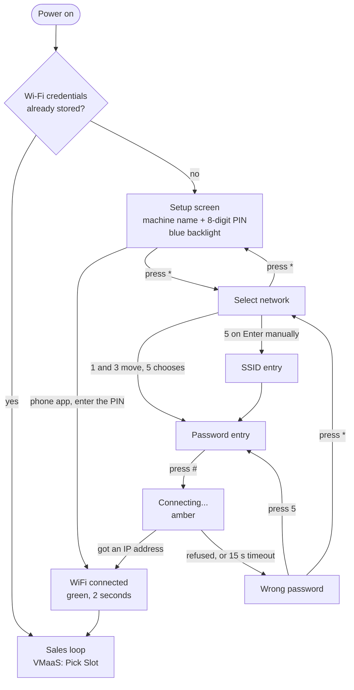
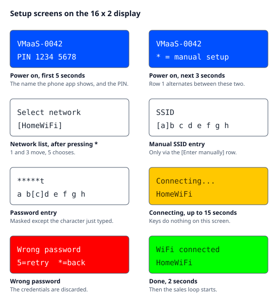
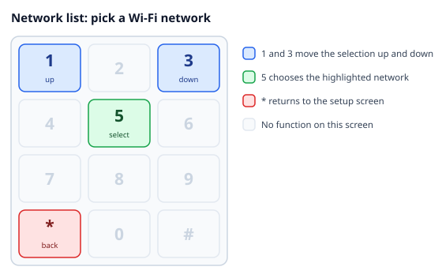
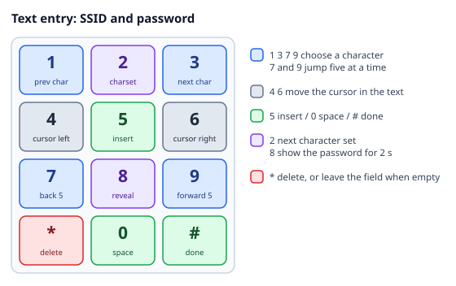
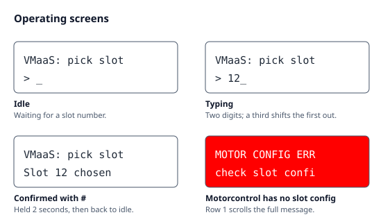
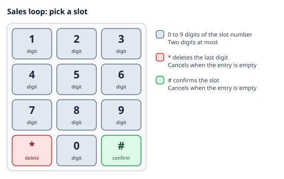
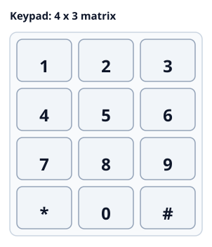

# First-Time Machine Setup

How to bring a VMaaS machine online the first time it is powered up, and what
every key on the keypad does once it is running.

This guide assumes both controllers are already flashed and wired, and that the
machine is assembled. It covers everything from the moment you switch the power
on.

**What you need**

- The machine, powered, with the 16x2 display and the keypad reachable.
- The Wi-Fi network name and password for the site.
- A phone with the Espressif **ESP BLE Provisioning** app, if you want to set the
  network up from the phone instead of the keypad. The keypad alone is enough.

---

## The whole flow at a glance

Setup runs **only when the machine has no stored Wi-Fi credentials**. Once it
succeeds, the machine goes straight to the sales loop on every later restart.

---

## Step 1: Power on

The display turns **blue** and shows the name of the machine on the top row. The
bottom row alternates every few seconds between the setup PIN and a reminder
that `*` starts manual setup.

The **machine name** comes from `device.name` in `config.json` — `VMaaS-0042` on
a configured machine. If that field is empty, the machine derives a name from its
own MAC address instead, like `VMaaS-3C7A91`.

The **PIN** is eight digits, drawn fresh at the start of every setup session. It
is never stored and never sent anywhere; it only ever appears on this screen. A
different PIN after a restart is normal, not a fault.

From here you have two ways to get the machine onto Wi-Fi. They are
interchangeable — pick whichever is convenient.

---

## Step 2, Path A: Set up from a phone

1. Open the ESP BLE Provisioning app and scan for devices.
2. Pick the machine by the name on the display.
3. Enter the eight-digit PIN from the display when the app asks for it.
4. Choose the Wi-Fi network in the app and enter its password.

The app drives the connection itself, so the machine stays on the blue setup
screen until it has an IP address and then goes straight to a green
`WiFi connected`. The amber `Connecting...` screen belongs to the keypad path
and is not shown here. After two seconds the sales loop starts.

Bluetooth stops as soon as setup finishes, so the machine is not discoverable
during normal operation.

---

## Step 2, Path B: Set up from the keypad

Press `*` on the setup screen. The machine lists the networks it found when it
booted, with `[Enter manually]` as the last row — use that row for a hidden
network, or if the list came up empty.

| Key | On the network list |
| --- | --- |
| `1` / `3` | Move the selection up / down. It stops at the ends rather than wrapping. |
| `5` | Choose the highlighted network. On `[Enter manually]`, open SSID entry. |
| `*` | Back to the setup screen. The phone app stays available. |
| others | Nothing. |

Choosing a network takes you to password entry; `[Enter manually]` takes you to
SSID entry first. Both screens use the same character picker, described next.

### Typing text on a 12-key keypad

The top row shows what you have typed. The bottom row shows a window of the
current character set with one character in brackets — that bracketed character
is the one `5` inserts.

| Key | In SSID and password entry |
| --- | --- |
| `1` / `3` | Move one character back / forward in the strip. |
| `7` / `9` | Jump five characters back / forward. |
| `2` | Next character set: lower case, UPPER CASE, digits, then symbols. |
| `4` / `6` | Move the cursor left / right inside the text you have typed. |
| `5` | Insert the bracketed character at the cursor. |
| `0` | Insert a space. |
| `8` | Show a masked password in clear for 2 seconds. Password field only. |
| `*` | Delete the character left of the cursor. On an empty field, leave the screen. |
| `#` | Finish the field. |

A password field shows every character as `*` except the one you just typed, so
you can check your typing without exposing the whole password. Press `8` to see
all of it briefly.

An SSID may not be empty. A password may — press `#` on an empty password field
to join an open network.

### Connecting

Pressing `#` on the password field starts the connection attempt. The display
turns amber and keys are inert until the machine has an answer, which takes up to
15 seconds.

- **Success:** green `WiFi connected`, two seconds, then the sales loop.
- **Failure:** red `Wrong password`. The credentials are discarded, so a typo
  never leaves the machine holding a network it cannot reach. Press `5` to retype
  the password, or `*` to go back to the network list.

---

## Step 3: Everyday use

Once the machine has a network it shows the sales prompt and waits for a slot
number.

| Key | In the sales loop |
| --- | --- |
| `0`–`9` | Append a digit. Two digits at most; a third shifts the first one out, so `1` `2` `3` leaves `23`. A leading zero is kept, so `0` `7` confirms as slot 7. |
| `*` | Delete the last digit. On an empty entry, cancel. |
| `#` | Confirm the slot. On an empty entry, cancel. |
| nothing for 10 s | A half-typed entry is discarded on its own. |

The result line stays on screen for 2 seconds before the prompt returns.

---

## Troubleshooting

| What you see | What it means |
| --- | --- |
| A different PIN after every restart | Correct by design. The PIN is drawn fresh per session and never stored. |
| `Wrong password` | The network refused the credentials, or no IP arrived within 15 seconds. Nothing was saved. Press `5` and retype. |
| The network list is empty apart from `[Enter manually]` | The boot scan found nothing. Use `[Enter manually]` and type the SSID. The list is not rescanned while setup is open — restart the machine to scan again. |
| `MOTOR CONFIG ERR`, red screen | The Motorcontroller has no valid slot configuration. Fix `config.json` on the Motorcontroller; the screen clears itself once it answers normally. |
| The display stays blank but the machine responds | The display failed to initialise. The machine keeps running headless and setup continues over Bluetooth; the PIN goes to the serial log. |
| No key does anything | The keypad failed to initialise. The boot log has one `selftest row N` line per row — check those first. |
| The setup screen never appears | The machine already has stored credentials and went straight to the sales loop. |

### Moving a machine to a different network

There is no on-device way to forget the stored network yet. A machine that needs
a different Wi-Fi network has to have its NVS partition erased over USB, after
which it comes up on the setup screen again.

---

## Where the values come from

These are read from `config.json` on the Main-Controller at boot, and every one
of them falls back to a built-in default if the file does not supply it.

| Setting | Field | Value shipped |
| --- | --- | --- |
| Machine name on screen and in the phone app | `device.name` | `VMaaS-0042` |
| How long a key must hold before it counts | `timings.keypad_debounce_ms` | 20 ms |
| Inactivity before a half-typed slot is dropped | `timings.slot_entry_timeout_ms` | 10 000 ms |
| How long a result line stays up | `timings.slot_entry_result_hold_ms` | 2 000 ms |

The timings that belong to setup itself — the 5 s PIN phase, the 3 s hint, the
2 s green hold, the 15 s connection timeout and the 2 s password reveal — are
fixed in the firmware.

## Physical keypad

For reference, the plain layout the three keypad diagrams above are based on:

